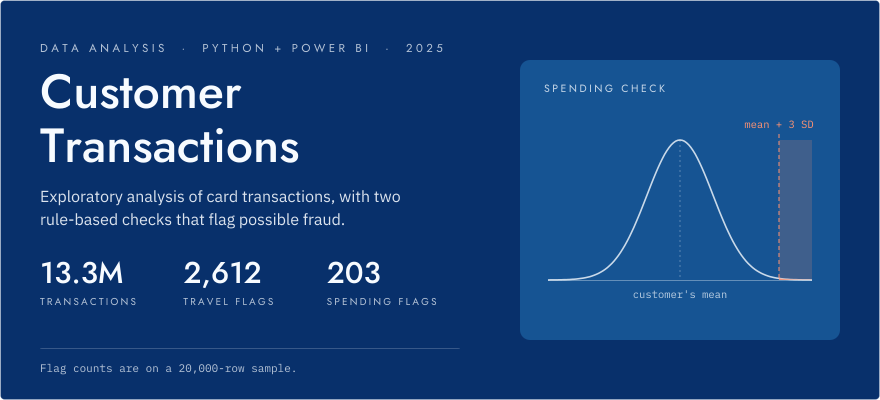
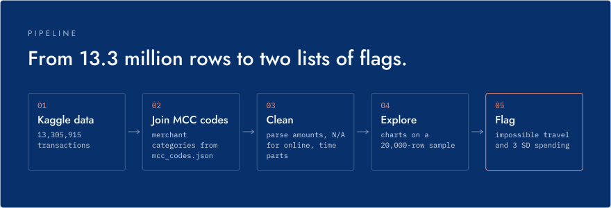
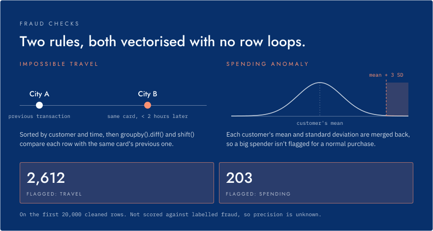

<p align="center">
  <picture>
    <source media="(prefers-color-scheme: dark)" srcset="assets/readme/hero-dark.svg">
    <source media="(prefers-color-scheme: light)" srcset="assets/readme/hero-light.svg">
    
  </picture>
</p>

<p align="center">
  <strong>Exploratory analysis of 13.3 million card transactions, with two rule-based fraud checks.</strong><br>
  <strong>2,612 impossible-travel flags &middot; 203 spending flags</strong> on a 20,000-row sample<br>
  <sub>Python, pandas, Matplotlib and Seaborn in Google Colab, plus a Power BI report. Data: Kaggle Transactions Fraud Datasets. <a href="#fraud-checks">Details</a>.</sub>
</p>

<p align="center">
  
  
  
  <a href="https://colab.research.google.com/github/haashirk20/customertransactionanalysis/blob/main/businessanalsytproject.ipynb"></a>
</p>

<p align="center">
  <a href="https://colab.research.google.com/github/haashirk20/customertransactionanalysis/blob/main/businessanalsytproject.ipynb">Open the notebook in Colab</a> &middot; <a href="businessanalsytproject.ipynb">view it on GitHub with all charts</a> &middot; Power BI report: <a href="transactionBA.pbix"><code>transactionBA.pbix</code></a>
</p>

---

The project uses the Kaggle [Transactions Fraud Datasets](https://www.kaggle.com/datasets/computingvictor/transactions-fraud-datasets): 13,305,915 transactions. It looks at when, where and with whom customers spend, then flags two kinds of suspicious activity.

## Pipeline

<p align="center">
  <picture>
    <source media="(prefers-color-scheme: dark)" srcset="assets/readme/pipeline-dark.svg">
    <source media="(prefers-color-scheme: light)" srcset="assets/readme/pipeline-light.svg">
    
  </picture>
</p>

Cleaning runs in pandas on the full dataset: merchant category descriptions are joined from `mcc_codes.json`, duplicates are dropped, `$` amounts become floats, online transactions get `N/A` for state and ZIP, and each timestamp is split into hour, weekday and month. The cleaned data is exported to `df_merged.csv`.

Charts and both checks run on the first 20,000 rows of the cleaned data. The notebook charts transaction volume by hour, the top 10 customers by total spend, the top 10 merchants by transaction count, the top 10 merchant cities by amount spent, chip vs. non-chip transactions, and a per-customer spending scatter plot. The Power BI report adds a geographic heatmap of transactions across countries and US states, and total amount by revenue stream.

## Fraud checks

<p align="center">
  <picture>
    <source media="(prefers-color-scheme: dark)" srcset="assets/readme/fraud-checks-dark.svg">
    <source media="(prefers-color-scheme: light)" srcset="assets/readme/fraud-checks-light.svg">
    
  </picture>
</p>

The travel check sorts transactions by customer and time, then uses `groupby().diff()` and `groupby().shift()` to compare each transaction with the same customer's previous one. The spending check computes each customer's mean and standard deviation once, merges them back onto the transactions, and compares every row in a single expression. Both checks are vectorised, with no Python loops over rows.

These are counts of flagged rows. The checks have not been scored against labelled fraud cases, so their precision is unknown.

## Getting started

The notebook downloads its data with the Kaggle API, so you need a Kaggle account and an API token (`kaggle.json`).

1. Open the notebook in [Google Colab](https://colab.research.google.com/github/haashirk20/customertransactionanalysis/blob/main/businessanalsytproject.ipynb).
2. Upload `kaggle.json` to the Colab session.
3. Run all cells. The first cell installs the Kaggle CLI, downloads `computingvictor/transactions-fraud-datasets`, and unzips `transactions_data.csv` and `mcc_codes.json`.

To run locally instead, install the dependencies and download the dataset yourself:

```sh
pip install pandas numpy matplotlib seaborn kaggle jupyter
kaggle datasets download -d computingvictor/transactions-fraud-datasets
unzip transactions-fraud-datasets.zip
jupyter notebook businessanalsytproject.ipynb   # skip the first cell, which sets up Kaggle for Colab
```

`businessanalsytproject.py` is Colab's export of the notebook. It contains `!` shell lines, so it won't run as a plain Python script.

## Contact

[LinkedIn](https://www.linkedin.com/in/mohammed-haashir-khan/) or `haashir.khan@mail.utoronto.ca`.
